```mermaid
stateDiagram-v2
    direction LR
    [*] --> Assessment: 1. Assessment
    Assessment --> WaitRelease: 2. Scale to 0 & Cache
    WaitRelease --> BackupJob: 3. Wait PVC Release
    BackupJob --> StreamUpload: 4. Trigger Backup Job
    StreamUpload --> Restoration: 5. Tar.gz Stream to Storage
    Restoration --> [*]: 6. Restore Replicas
```

```mermaid
stateDiagram-v2
    direction LR
    [*] --> Assessment: 1. Assessment
    Assessment --> SidecarJob: 2. Keep Replicas >0
    SidecarJob --> UnixPipe: 3. Trigger Dumper+Worker Job
    UnixPipe --> StreamUpload: 4. pg_dump to FIFO Pipe
    StreamUpload --> Cleanup: 5. Compress & Upload .sql.gz
    Cleanup --> [*]: 6. Purge Backup Jobs
```

# bkup
**Cloud-Agnostic Kubernetes Backup Tool**

> bkup is a lightweight, production-grade, cloud-agnostic backup tool that safely secures Kubernetes volumes into remote storage like Azure Blob Storage or AWS S3.


* :minidisc: **Export** Kubernetes data to remote storage.
* :recycle: **Import** backed-up data to Kubernetes.
* :package: **Backups Isolation:** Each Kubernetes namespace is backed up into a dedicated space.
* :closed_lock_with_key: **Ensure data Integrity:** Scale-down running workload, backup their volumes and restore the workload.
* :pinching_hand: **Cloud-Native & Minimalist:** Light footprint, easy to install, and fully customizable from standard Kubernetes manifests without third-party CRD dependencies.


## Requirements
* Remote storage (Azure Blob Storage, S3 etc...), with credentials
* Working Kubernetes cluster


## Installation
> [!CAUTION]
> This tool is based on **scaling down** Kubernetes **pods** to orchestrate a clean backup plan. \
> You should probably try it on a test environment first.

* Install CLI
  * Create venv
    ```
    python -m .venv
    source .venv/bin/activate
    ```

  * Install dependencies
    ```
    pip install --upgrade pip
    pip install -r requirements.txt
    ```

* Create Kubernetes objects
  * [optional] `pullImage` secret
    > To get the image from this repository
    ```
    kubectl create secret docker-registry bkup-registry-auth \
      --docker-server=ghcr.io \
      --docker-username=GITHUB_ACCOUNT \
      --docker-password=GITHUB_PAT \
      --docker-email=GITHUB_ACCOUNT
    ```

  * `config` Secret
    * Edit `templates_install/config.secret.yaml` with your own config
    * Apply
      ```
      NAMESPACE=YOUR_NAMESPACE envsubst < templates_install/config.secret.yaml | kubectl apply -f -
      ```

  * `backup-map` ConfigMap
    > Note: this ConfigMap is used to orchestrate the backup. \
    > You can manually edit it to customize the backup behaviors, the command below is just a quick way to create it. \
    > If it already exists, you can read it with `bkup -c KUBECTL_CONTEXT -bm -g` or `kubectl get cm bkup-backup-map`
    ```
    bkup -c KUBECTL_CONTEXT -bm
    ```
    

## Usage
> Ensure required secrets & configmap are created
### Kubernetes
* Create pod (& required resources such as RBAC etc...)
```
NAMESPACE=YOUR_NAMESPACE envsubst < templates_install/resources_test.yaml | kubectl apply -f -
```
* Wait for it to end...

### Local CLI
* Run cluster-wide backup
```
bkup -c KUBECTL_CONTEXT
```

* Run namespaced backup
```
bkup -c KUBECTL_CONTEXT -n NAMESPACE
```

* Display help
```
bkup --help
```


## Developpers
### Architecture
* `master.py`   => entrypoint of the master pod (orchestrate backup jobs, scaling replicas etc...)
* `exporter.py` => entrypoint of the exporter pod (do the backup = dump persisted storage & sync it to remote storage)
* `importer.py` => entrypoint of the importer pod (import backups from remote storage to Kubernetes)


### ConfigMap `backup-map`
bkup relies on a ConfigMap called the `backup-map` to orchestrate its backups plans.

The `backup-map` is really simple:
* consists of listing workloads (Deployments/StatefulSets) and their associated PVC if any
* must be generated before running bkup jobs
* can/must be manually modified => The backup-map is pre-gen but some informations are not predictable, any "CHANGEME" values must be replaced
* stored in namespace of the `master pod` (or default namespace if bkup is not running in the cluster)


#### Example
```
bkup-backup-map.yaml: |
  cluster: example
  namespaces:
  - name: namespace1
    claims: []
  - name: namespace2
    claims: []
  - name: namespace3
    claims:
    - name: pvc-workload1
      backup-type: volume
      attachment-node: node-example
      mounts:
      - container: example
        path: /data
        resource: Deployment/example1

    - name: pvc-workload2
      backup-type: volume
      attachment-node: node-example
      mounts:
      - container: example
        path: /data
        resource: StatefulSet/example2

    - name: pvc-postgresql
      backup-type: pg_dump
      attachment-node: node-example
      mounts:
      - container: postgresql
        path: /data
        resource: StatefulSet/postgresql
      postgresql:
        port: 5432
        user: postgres
        password-secret:
          name: postgresql-config
          key: postgres-password
```


#### Tweaks
Everything in the backup-map can be tweaked. \
Here is the list of configurable keys:

| key                                                   | value           | info
|-------------------------------------------------------|-----------------|------
| **`claims[]`**                                        | *list*          | List of PersistentVolumeClaims (PVCs) to orchestrate within the namespace. If empty = nothing to backup.
| **`claims[].attachment-node`**                        | *string*        | Name of the Kubernetes node where the PVC is attached. Useful if storage is node-constrained.
| **`claims[].mounts[].path`**                          | *string*        | Container mount path where data to back up is located.
| **`claims[].backup-type`**                            | **`volume`**    | The backup job will create a `.tar.gz containing data of the mounted paths` found in the PVC.
| **`claims[].backup-type`**                            | **`pg_dump`**   | The backup job will use `pg_dump to create a .sql` dump of all the databases found in the PVC.
| **`claims[].postgresql`**                             | *dictionary*    | Configuration block for PostgreSQL database access.
| **`claims[].postgresql.host`**                        | *string*        | Hardcoded PostgreSQL host/IP. *Default: Dynamic Pod IP.*
| **`claims[].postgresql.port`**                        | *integer*       | Hardcoded connection port. *Default: 5432.*
| **`claims[].postgresql.user`**                        | *string*        | Hardcoded PostgreSQL username *(Overrides `user-secret`)*. *Default: postgres.*
| **`claims[].postgresql.user-secret`**                 | *dictionary*    | Secret reference for username.
| **`claims[].postgresql.user-secret.name`**            | *string*        | Name of the target Kubernetes Secret.
| **`claims[].postgresql.user-secret.key`**             | *string*        | Data key inside the Secret holding the username value.
| **`claims[].postgresql.user-secret.namespace`**       | *string*        | *(Optional)* Target Secret namespace if different from current PVC namespace.
| **`claims[].postgresql.password-secret`**             | *dictionary*    | **[REQUIRED]** Secret reference for password.
| **`claims[].postgresql.password-secret.name`**        | *string*        | Name of the target Kubernetes Secret.
| **`claims[].postgresql.password-secret.key`**         | *string*        | Data key inside the Secret holding the password value.
| **`claims[].postgresql.password-secret.namespace`**   | *string*        | *(Optional)* Target Secret namespace if different from current PVC namespace.
| **`claims[].postgresql.db`**                          | *string*        | Hardcoded target database name *(Overrides `db-secret`)*.
| **`claims[].postgresql.db-secret`**                   | *dictionary*    | Secret reference for database name.
| **`claims[].postgresql.db-secret.name`**              | *string*        | Name of the target Kubernetes Secret.
| **`claims[].postgresql.db-secret.key`**               | *string*        | Data key inside the Secret holding the database name value.
| **`claims[].postgresql.db-secret.namespace`**         | *string*        | *(Optional)* Target Secret namespace if different from current PVC namespace.

> [!CAUTION]
> **Security Note:** Plain-text `password` keys are strictly forbidden in `backup-map`. Always use `password-secret`.


### ConfigMap `backup-cache`
The `backup-cache` ConfigMap is an internal state tracker used during backup execution. 
* It stores the initial replica counts of all scaled-down workloads before the backup starts.
* If the master script crashes, gets killed, or receives a termination signal (`SIGINT`/`SIGTERM`), it reads this cache during the recovery phase to reliably restore production workloads to their original state.
* Once the backup and restoration sequence finishes successfully, the cache is automatically purged.


### Secret `config`
The `config` Secret is the core configuration secret required to operate. It must be created prior to running backup operations and contains remote storage credentials and target metadata:
* `backup-map-namespace`: *(Optional)* The target namespace where `bkup-backup-map` and `bkup-backup-cache` are stored.
* `cluster-name`: Name descriptor of the targeted Kubernetes cluster.
* `storage-address`: Endpoint URL of the remote storage (e.g., `https://<account>.blob.core.windows.net/`).
* `storage-username`: Storage account username or Access Key.
* `storage-password`: Storage account password or Secret Access Key.
### Workflows
#### Volumes
* Run a Kubernetes job to dump content of PVC mount points
##### Export



##### Import
tofill


#### PostgreSQL
* Run a Kubernetes job based on the original PostgreSQL image (to get same version) to dump databases
##### Export



##### Import
tofill


## License
This project is licensed under the MIT License. See the [LICENSE file](https://raw.githubusercontent.com/Cosmo-Tech/bkup/main/LICENSE.md) for details.

<br>
<br>
<br>

Made with :heart: by Cosmo Tech DevOps team
