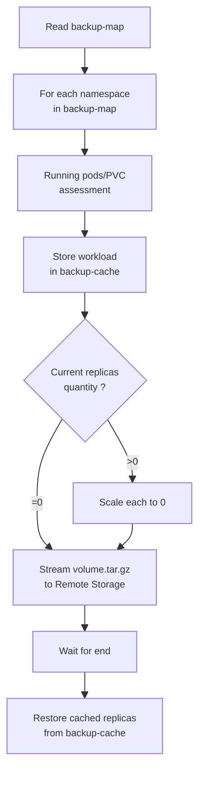
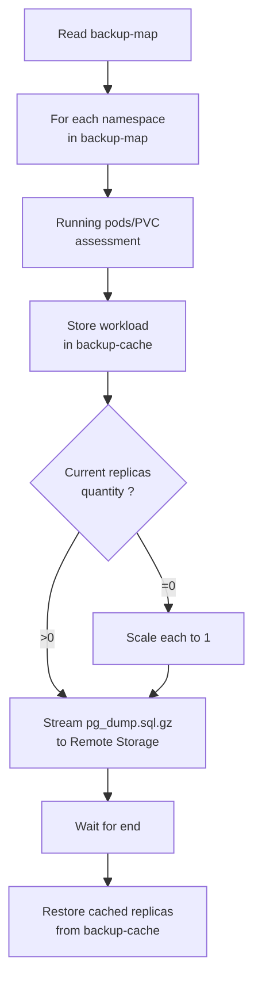

# bkup
**Cloud-Agnostic & Kubernetes-native backup tool**

**bkup** is a lightweight, production-grade, cloud-agnostic & Kubernetes-native backup tool that safely secures Kubernetes volumes into remote storage like Azure Blob Storage, AWS S3 etc...

* :minidisc: **Export** Kubernetes data to remote storage.
* :recycle: **Import** backed-up data to Kubernetes.
* :package: **Backups Isolation:** Each Kubernetes namespace is backed up into a dedicated space.
* :closed_lock_with_key: **Ensure data Integrity:** Scale-down running workload, backup their volumes and restore the workload.
* :pinching_hand: **Cloud-Native & Minimalist:** Light footprint, easy to install, and fully customizable from standard Kubernetes manifests without third-party CRD dependencies.
* Native Kubernetes volumes backups
* Native PostgreSQL databases backups

<br>

## Requirements
* Remote storage (Azure Blob Storage, S3 etc...), with credentials
* Working Kubernetes cluster

<br>

## Installation
> [!CAUTION]
> This tool is based on **scaling down** Kubernetes **pods** to orchestrate a clean backup plan. \
> You should probably try it on a test environment first.

* From CLI
  ```
  python -m .venv
  source .venv/bin/activate
  pip install .
  ```

* From Helm Chart
  ```
  helm -n NAMESPACE upgrade --install bkup helm-chart/cosmotech-kubernetes-backup --values values.yaml
  ```

<br>

## How to
### Backup
Trigger the cronjob installed from the Helm Chart (or wait for it)
### Restore
```
python -m src.cli import -f <file_from_your_remote_storage>
```

### Workflows
#### Volumes
* Run a Kubernetes job to dump content of PVC mount points

##### Export


##### Import
tofill

<br>

#### PostgreSQL
* Run a Kubernetes job based on the original PostgreSQL image (to get same version) to dump databases

##### Export


##### Import
tofill

<br>

## License
This project is licensed under the MIT License. See the [LICENSE file](https://raw.githubusercontent.com/Cosmo-Tech/bkup/main/LICENSE.md) for details.

<br>
<br>
<br>

Made with :heart: by Cosmo Tech DevOps team
